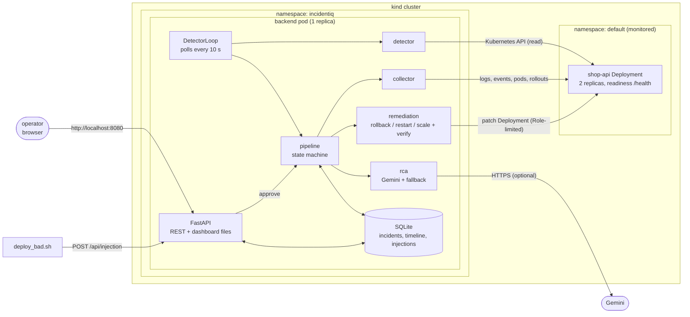
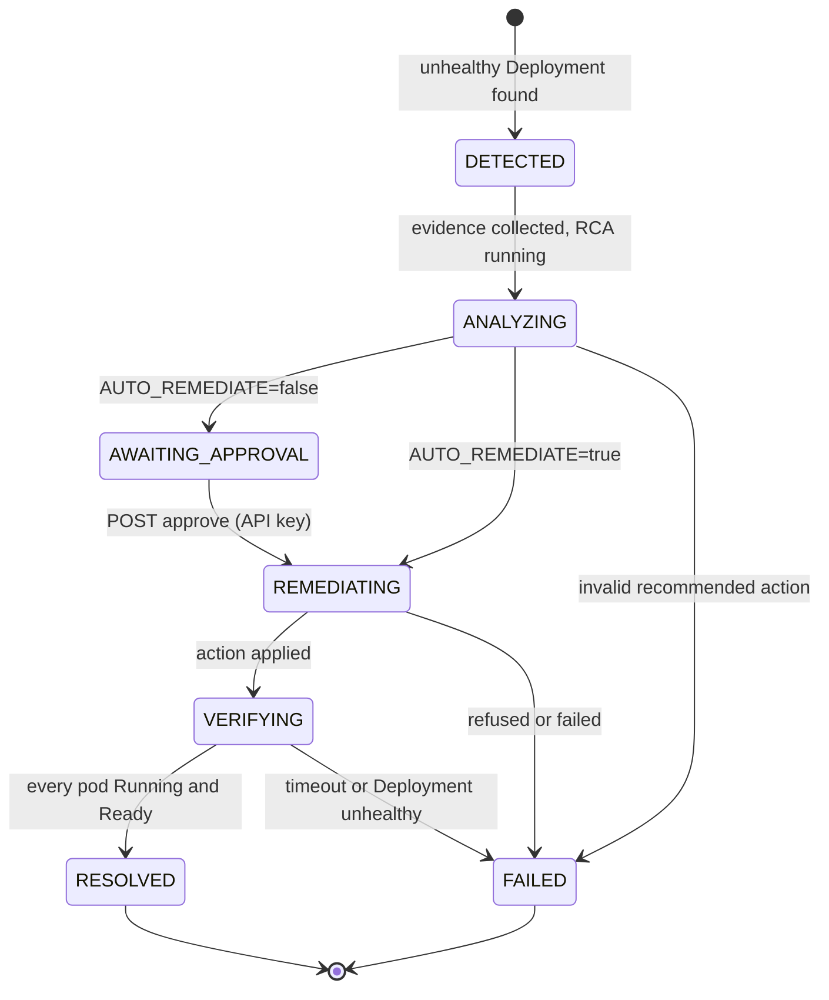

# IncidentIQ architecture

IncidentIQ is one Python process (the *backend*) plus a demo workload, both running in a local kind cluster. The backend watches the
workload, and for each failure runs a fixed, guarded pipeline. Interfaces are defined in [contracts.md](contracts.md); this page
explains how the pieces fit together and why.

## Components

| Module | Responsibility | Never does |
|---|---|---|
| `detector` | Maps unhealthy pods to their Deployment and returns one `{service, namespace, reason}` per Deployment | raise; look outside allow-listed namespaces |
| `collector` | Gathers up to 50 log lines per container (previous logs for crashes), events, pod states, last change time, rollout history | store secrets (redacted) or env var values (names only); abort the incident on a partial failure |
| `rca` | Builds the prompt, calls Gemini, strictly validates the JSON, grounds quoted evidence, falls back deterministically | raise; let the model pick an action outside the allow-list |
| `remediation` | Checks guardrails, applies the action, verifies recovery | act without approval (unless `AUTO_REMEDIATE=true`), touch another namespace, exceed the attempt cap, treat "request accepted" as "recovered" |
| `pipeline` | Owns the lifecycle, writes every transition to the timeline, runs workers | create a second open incident for one service |
| `api` | REST endpoints, authentication for writes, static dashboard with a strict CSP | accept the action to run from a client |
| `db` | SQLite persistence and the MTTD/MTTR arithmetic | invent a value for a missing timestamp |

## Incident lifecycle

Every arrow is a timeline entry. `RESOLVED` and `FAILED` both start the cooldown (default 60 s) during which the same service
cannot open a new incident, which prevents incident storms.

## Data flow for one incident

1. `deploy_bad.sh` calls `POST /api/injection`; the timestamp is stored in the `injections` table.
2. `DetectorLoop` polls `detector.check_cluster()`. For a new issue it checks for an open incident and the cooldown, then starts one worker
   (at most 4 at a time, one per service).
3. The incident is created atomically; the newest eligible injection is **claimed** (recorded before detection, same service and namespace,
   not older than `INJECTION_MAX_AGE_SECONDS`) so MTTD can be computed. Stale injections can never attach to a later incident.
4. `collector.collect_evidence` runs, the result is saved, then `rca.analyze` runs and its result is saved.
5. With approval on, the incident waits. `POST /api/incidents/{id}/approve` performs an atomic compare-and-set to `REMEDIATING`, so two
   simultaneous clicks run the action once. The action is read from the stored RCA.
6. `remediation.execute` runs once; then `remediation.verify_with_detail` polls every 5 s. Only a passing verification sets `RESOLVED`
   and stamps `resolved_at`.
7. The dashboard polls the API every 3 s and renders what is stored.

## Diagnosis and fallback

The prompt begins with the exact SRE instruction from the specification, followed by the evidence. The reply must parse as JSON with
`probable_cause`, `evidence`, `confidence` in [0, 1] and `recommended_action` in `rollback|restart|scale`. Every quoted evidence line
must occur in the collected data; if all are invented the reply is rejected. On any failure the fallback runs: `rollback` when the last
deployment change was within 10 minutes, otherwise `restart`, labelled `source: fallback` with a fixed low confidence. This heuristic is for
the demo only. The model output is a recommendation; code, not the model, decides what executes.

## Safety layers (outermost first)

1. **Network:** the published port is bound to `127.0.0.1`; writes require `X-API-Key` (constant-time compare, checked before anything else).
2. **Kubernetes RBAC:** a namespaced Role that can only read workloads and patch Deployments.
3. **Allow-lists:** actions and namespaces, exact match, checked before any cluster call.
4. **Approval gate** and an atomic one-shot transition.
5. **Attempt limit** (max 2) and no repeated rollback within one incident.
6. **Verification** decides the final status.
7. **Input hygiene:** logs and events are untrusted; secrets are redacted; the dashboard never renders them as markup.

## Threading and restarts

The detector loop and the per-incident workers are threads inside the single backend process, started on application startup and stopped
on shutdown (`stop()` wakes the loop immediately; `join_workers` waits for in-flight work). SQLite gets a new connection per operation plus a
lock. If the process dies mid-incident, the next start marks `DETECTED/ANALYZING/REMEDIATING/VERIFYING` incidents `FAILED` ("interrupted by a
backend restart") and keeps `AWAITING_APPROVAL` ones. This is also why the backend must be exactly one replica.

## Known limitations

* SQLite on an `emptyDir`: data is lost when the pod is recreated. Use a PersistentVolume for anything longer-lived.
* One backend replica, no high availability, no TLS, read endpoints unauthenticated (local demo).
* The fallback heuristic and the model's analysis are best effort and can be wrong; verification and the approval gate exist for that reason.
* Only Deployment-owned pods are detected; namespaces other than `default` need their own Role/RoleBinding.
